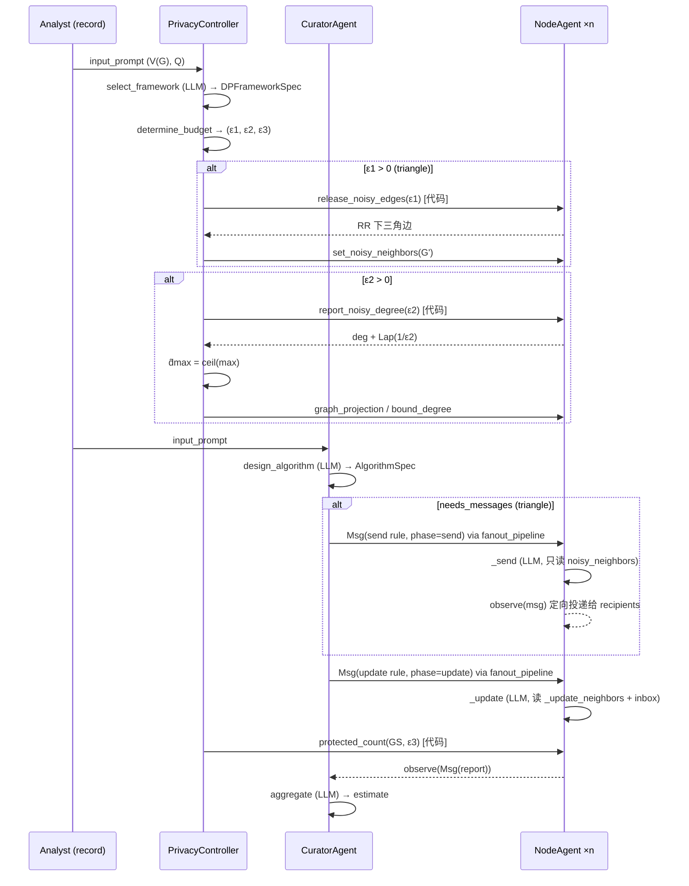

# PSC 项目详细实现方案

> 项目：*Agent-based Substructure Counting under Local Differential Privacy*（ACL 2026）的代码复现
> 技术栈：Python 3 + AgentScope 1.0 + NumPy
> 版本：`psc 0.1.0`

---

## 目录

1. [项目目标与范围](#1-项目目标与范围)
2. [总体架构](#2-总体架构)
3. [模块划分与职责](#3-模块划分与职责)
4. [数据层：图结构与统一数据格式](#4-数据层图结构与统一数据格式)
5. [隐私机制层：DP 原语](#5-隐私机制层dp-原语)
6. [知识库层：算法库与 DP 框架库](#6-知识库层算法库与-dp-框架库)
7. [智能体层：三类 Agent 的设计](#7-智能体层三类-agent-的设计)
8. [编排层：PSC 与 Naive 的执行流程](#8-编排层psc-与-naive-的执行流程)
9. [Prompt 设计与输出解析](#9-prompt-设计与输出解析)
10. [模型层：多 Provider 与离线 Mock 模型](#10-模型层多-provider-与离线-mock-模型)
11. [Ground Truth：纯 Python 参考实现](#11-ground-truth纯-python-参考实现)
12. [附录 B 基线：RAW / REFINED / PSC-noDP](#12-附录-b-基线raw--refined--psc-nodp)
13. [实验体系](#13-实验体系)
14. [测试与验证策略](#14-测试与验证策略)
15. [隐私保证分析](#15-隐私保证分析)
16. [成本与复杂度](#16-成本与复杂度)
17. [关键设计决策](#17-关键设计决策)
18. [已知限制与后续工作](#18-已知限制与后续工作)
19. [快速运行参考](#19-快速运行参考)

---

## 1. 项目目标与范围

### 1.1 问题背景

在**边本地差分隐私（edge LDP）**下，图中每个节点只信任自己，不希望向任何第三方（包括作为分析者的 LLM）暴露真实的邻接关系。目标是在该约束下让 LLM 智能体系统完成四类**子结构计数**任务：

| 任务 | 统计量 \(f(G)\) |
|---|---|
| `degree` | 平均度 \(2m/n\) |
| `2-star` | \(\sum_v \binom{d_v}{2}\) |
| `3-star` | \(\sum_v \binom{d_v}{3}\) |
| `triangle` | 三角形总数 |

论文提出 **PSC（Private Substructure Counting）框架**：由 curator agent 设计分布式算法，节点智能体在本地执行 send/update，隐私控制器以代码执行所有噪声机制，最后 curator 聚合噪声报告。

### 1.2 复现范围

| 内容 | 状态 |
|---|---|
| Algorithm 1 BuildNoisyGraph（随机响应噪声图） | 已实现 |
| Algorithm 2 GSOptimize（噪声最大度 + 图投影） | 已实现 |
| Algorithm 3 PSC 完整编排 | 已实现 |
| Naive 基线（2.4 节） | 已实现 |
| GT-Naive / GT-PSC / GT-PSC-B 纯 Python 版 | 已实现 |
| 附录 B：RAW / REFINED / PSC-noDP / Naive+REFINED | 已实现 |
| 附录 E：算法库与 DP 框架库规则文本 | 已实现（逐字对应） |
| 6 个真实数据集的下载与预处理（附录 A 格式） | 已实现 |
| Exp1–Exp6 实验脚本 + 论文参考值对照 | 已实现 |
| 离线 Mock LLM（无需 API 即可跑通端到端） | 已实现 |
| OpenAI / DashScope / Ollama 真实模型接入 | 已实现 |
| 附录 C token 统计（Exp8）、附录 D 节点采样（Exp9） | 未实现 |

---

## 2. 总体架构

### 2.1 分层视图

```
┌──────────────────────────────────────────────────────────────────────┐
│  实验层  scripts/run_experiments.py  scripts/run_ground_truth.py     │
│          psc/experiments.py（运行器、论文参考值、Markdown 表格）      │
├──────────────────────────────────────────────────────────────────────┤
│  编排层  psc/framework.py                                            │
│          PSCFramework (Alg.3)   NaiveFramework (Alg.1 + curator)     │
│          psc/baselines.py  SingleLLMBaseline (RAW / REFINED)         │
├──────────────────────────────────────────────────────────────────────┤
│  智能体层  psc/agents/                                               │
│    NodeAgent          CuratorAgent          PrivacyController        │
│    (send/update 由 LLM)  (设计算法/聚合)     (选框架 + 全部噪声代码)   │
├────────────────────────────┬─────────────────────────────────────────┤
│  知识库层  psc/library.py  │  Prompt 层  psc/prompts.py              │
│    ALGORITHM_LIBRARY       │    自然语言 + <structured_input> 块      │
│    DP_FRAMEWORK_LIBRARY    │    extract_json / extract_number        │
├────────────────────────────┴─────────────────────────────────────────┤
│  规则语义层  psc/rules.py（send/update/aggregate 的代码实现，GT 与 Mock 共用） │
├──────────────────────────────────────────────────────────────────────┤
│  隐私原语层  psc/dp.py   RR / Laplace / GSOptimize / 预算分配         │
├──────────────────────────────────────────────────────────────────────┤
│  模型层  psc/models.py  ModelConfig + create_model/create_formatter  │
│          psc/mock_model.py  MockChatModel（规则完美执行器）           │
├──────────────────────────────────────────────────────────────────────┤
│  数据层  psc/graph.py   Graph / TaskRecord / 附录 A 格式             │
│          data/*.json    scripts/prepare_datasets.py                  │
└──────────────────────────────────────────────────────────────────────┘
```

### 2.2 核心设计原则

1. **隐私机制只由代码执行（Challenge 1）**
   RR、Laplace、图投影、ε 拆分全部在 `dp.py` 中实现，由 `PrivacyController` 调用；LLM 从不参与噪声注入。隐私保证因此与 LLM 是否"听话"无关。

2. **真实邻居与噪声邻居的内存隔离**
   `NodeAgent` 持有 `_real_neighbors`（私有，只供 update 与本地 DP 例程读取）和 `noisy_neighbors`（公开，只供 send 读取）。send 阶段永远不接触真实边。

3. **规则文本与规则语义解耦**
   `library.py` 保存给 LLM 看的自然语言规则；`rules.py` 提供同一规则的代码语义。二者共同服务 GT 算法与 Mock 模型，保证"完美 LLM"版本与纯 Python 版本在统计上等价。

4. **每条 prompt 附带机器可读块**
   `<structured_input>{...}</structured_input>` 让 Mock 模型无需理解自然语言即可精确执行，也为真实 LLM 提供无歧义的输入。

5. **Provider 无关**
   通过 `ModelConfig` + 工厂函数切换 mock / openai / dashscope / ollama，智能体代码零改动。

---

## 3. 模块划分与职责

```
psc/
  __init__.py            版本号
  graph.py               Graph 数据结构、任务定义、附录 A TaskRecord、数据集 IO
  dp.py                  RR、Laplace、噪声最大度、图投影、邻居表投影、预算分配
  library.py             AlgorithmSpec / DPFrameworkSpec 与两个库
  rules.py               send / update / aggregate / naive_answer 的代码语义
  prompts.py             系统提示词、阶段 prompt 模板、RAW/REFINED 模板、解析工具
  mock_model.py          MockChatModel：按 <structured_input>.phase 分派到 rules
  models.py              ModelConfig、create_model、create_formatter、chat()
  ground_truth.py        gt_naive / gt_psc / relative_error / average_relative_error
  baselines.py           附录 B：few-shot 示例生成、SingleLLMBaseline
  framework.py           RunResult、_AgentFactory、PSCFramework、NaiveFramework
  experiments.py         论文 Table 2/3/4/5 参考值、GT 与智能体运行器、表格渲染
  agents/
    node_agent.py        NodeAgent
    curator_agent.py     CuratorAgent
    privacy_controller.py PrivacyController
scripts/
  prepare_datasets.py    下载 + 重标号 + 生成 data/{CU,Do,ML,CS,EE,PM}.json
  run_ground_truth.py    GT 实验 CLI
  run_experiments.py     exp1–exp6 CLI
tests/
  test_psc.py            13 个单元/集成测试
  test_openai_path.py    本地 OpenAI 协议桩服务器端到端测试
data/                    预处理后的数据集 + raw/ 原始压缩包缓存
results/                 实验输出：<实验>/<标签>/{summary.json, runs.json, table.md}
paper/                   论文 PDF 与文本
```

### 3.1 模块依赖关系

```
graph ──> dp ──> ground_truth
  │        │
  │        └──> agents/* ──> framework ──> experiments ──> scripts
  │                 ▲            ▲
  ├──> library ─────┤            │
  ├──> rules ───────┼──> mock_model ──> models
  └──> prompts ─────┘                    ▲
                                          │
                     baselines ───────────┘ (延迟导入 framework 避免环)
```

---

## 4. 数据层：图结构与统一数据格式

### 4.1 `Graph`（`psc/graph.py`）

- 表示：`n: int` + `adj: list[set[int]]`，节点编号 `0..n-1`，无向简单图。
- 构造：`from_edges` / `from_edge_string` / `from_adjacency`；自动去自环、去重。
- 统计：`degree` / `degrees` / `max_degree` / `average_degree` / `count_kstars(k)` / `count_triangles` / `local_triangles(u)` / `ground_truth(task)`。
- `count_triangles` 对 \(n \le 300\) 用集合交集，大图用 `einsum("ij,ij->", A@A, A) / 6` 加速。
- 序列化：`edge_string()` → `"(0, 1) (0, 2) ..."`；`adjacency_matrix()` 供向量化 RR 使用。

### 4.2 任务提示词

`task_prompt(task, n, ldp=True)` 生成附录 A 格式的 `input_prompt`：

```
<任务定义> [Each node may hide its edge information under the local edge
differential privacy framework.] Q: The nodes are numbered from 0 to n-1. <问题>
```

- 2-star 的描述与附录 A 逐字一致。
- `ldp=False` 去掉 LDP 声明，供 PSC-noDP / RAW 基线使用。
- `infer_task_from_prompt` 为规则回退：LLM 选任务失败时按关键词推断。

### 4.3 `TaskRecord` 与数据集文件

每个数据集一个 JSON 文件，包含 4 条记录（每任务一条）：

```json
{
  "index": 1, "input_prompt": "...", "edges": "(0, 1) (0, 2) ...",
  "vertex_num": 49, "edge_num": 107, "answer": 4.367,
  "task": "degree", "dataset": "CU"
}
```

`load_dataset(data_dir, "CU")` 返回 `{task: TaskRecord}`；`record.graph()` 重建 `Graph`。

### 4.4 数据集准备（`scripts/prepare_datasets.py`）

| 缩写 | 全称 | \|V\| | \|E\| | 来源 |
|---|---|---|---|---|
| CU | Contiguous USA | 49 | 107 | KONECT `contiguous-usa` |
| Do | Dolphins | 62 | 159 | KONECT `dolphins` |
| ML | Les Misérables | 77 | 254 | networkx 内置 |
| CS | ca-sandi_auths | 86 | 124 | Network Repository |
| EE | email-enron-only | 143 | 623 | Network Repository |
| PM | C. elegans metabolic | 453 | 2025 | KONECT `arenas-meta` |

流程：下载（缓存到 `data/raw/`）→ 解析 KONECT `out.*` 或 MatrixMarket `.mtx` → `relabel_edges` 重标号到 `0..n-1` 并去自环/重边 → 与论文 Table 1 的 \((|V|,|E|)\) 校验 → `build_records` 写出。

---

## 5. 隐私机制层：DP 原语

全部位于 `psc/dp.py`，是纯函数，接收显式的 `np.random.Generator` 以保证可复现。

### 5.1 随机响应（Algorithm 1）

- 翻转概率 \(p = \frac{1}{1+e^{\varepsilon}}\)（`flip_probability`，带 exp 溢出保护）。
- **只扰动下三角** \(a_{i,j},\ j<i\)：每条潜在边只由编号较大的端点扰动一次，避免双端各扰动一次造成的隐私预算翻倍。
- 节点级：`node_noisy_lower_row(node_id, neighbors, eps, rng)` 由 `NodeAgent.release_noisy_edges` 调用，返回该节点发布的 `(i, j)` 边。
- 全图级：`build_noisy_graph(graph, eps, rng)` 为向量化等价实现，供 GT 使用。

### 5.2 Laplace 机制

`laplace_mechanism(value, sensitivity, eps, rng)` = `value + Lap(sensitivity / eps)`；`eps <= 0` 抛异常。

### 5.3 全局灵敏度优化（Algorithm 2）

```
noisy_max_degree(degrees, eps2, rng):
    noisy_i = deg_i + Lap(1/eps2)          # 度的灵敏度为 1
    d̂max   = max(1, ceil(max_i noisy_i))   # 向上取整，保守
```

两种投影：

| 函数 | 适用 | 行为 |
|---|---|---|
| `graph_projection(G', d_max, rng)` | triangle（有噪声图） | 随机顺序遍历节点，度 > d_max 者随机保留 d_max 个邻居，**对称删边**，结果仍是无向简单图且 max degree ≤ d_max |
| `project_neighbor_list(nbrs, d_max, rng)` | k-star（无噪声图） | 对单个节点的真实邻居表随机保留 d_max 个 |

### 5.4 预算分配（4.1 节）

```python
split_budget(eps, need_noisy_graph, need_gs_optimization, r1=0.5, r2=0.2)
    eps1 = r1 * eps            if need_noisy_graph      else 0
    eps2 = r2 * (eps - eps1)   if need_gs_optimization  else 0
    eps3 = eps - eps1 - eps2
```

ε = 2 时的实际拆分：

| 方法 / 任务 | eps1 (RR) | eps2 (d̂max) | eps3 (计数) |
|---|---|---|---|
| PSC triangle | 1.0 | 0.2 | 0.8 |
| PSC 2-star / 3-star | 0 | 0.4 | 1.6 |
| PSC degree | 0 | 0 | 2.0 |
| PSC-B triangle | 1.0 | 0 | 1.0 |
| Naive（任意任务） | 2.0 | 0 | 0 |

`BudgetSplit` 为 frozen dataclass，`total` 属性用于测试守恒。

---

## 6. 知识库层：算法库与 DP 框架库

### 6.1 `ALGORITHM_LIBRARY`（curator 查询）

`AlgorithmSpec` 字段：`task, title, problem, state, message, initialization, send, update, aggregate, needs_messages`。

| 任务 | send | update | aggregate | 需要消息 |
|---|---|---|---|---|
| triangle | 向每个邻居发送 `{Sender_ID, Sender_Neighbors}` | 丢弃非邻居消息；对每条消息取公共邻居数 × 0.5 累加 | 求和 / 3，负数截 0 | 是 |
| degree | 无 | `Degree` = 邻居数 | 求和 / n，负数截 0 | 否 |
| k-star | 无 | `Star_Count` = C(degree, k) | 求和，负数截 0 | 否 |

三角形的 send/update/aggregate 文本与附录 E 逐字对应（含示例："Node 5 with neighbors [2,4] 收到两条消息 … 输出 0.5"）。

### 6.2 `DP_FRAMEWORK_LIBRARY`（privacy controller 查询）

`DPFrameworkSpec` 字段：`task, title, sensitivity_text, noisy_graph, gs_optimization, _sensitivity(n, d_hat_max)`。

| 任务 | 需噪声图 | 可 GS 优化 | 灵敏度（有 d̂max） | 灵敏度（无优化） |
|---|---|---|---|---|
| degree | 否 | 否 | 1 | 1 |
| 2-star | 否 | 是 | C(d̂max, 1) = d̂max | C(n, 1) = n |
| 3-star | 否 | 是 | C(d̂max, 2) | C(n, 2) |
| triangle | 是 | 是 | max(1, d̂max − 1) | n − 2 |

三角形采用附录 E 库条目 `Sensitivity: degree-1`：投影后 \(d̂_{max}-1\)，无投影时最大度 \(n-1\) → \(n-2\)（对应论文 Challenge 3）。

两个库都提供 `*_summary()` 生成给 LLM 的候选列表文本。

---

## 7. 智能体层：三类 Agent 的设计

三类 Agent 均继承 `agentscope.agent.AgentBase`，实现 `observe` / `reply`，并统计 `llm_calls` 与 `parse_failures`。

### 7.1 `NodeAgent`（`agents/node_agent.py`）

**内存布局**

| 字段 | 可见性 | 读取方 |
|---|---|---|
| `_real_neighbors` | 私有 | update 阶段、`release_noisy_edges`、`report_noisy_degree` |
| `_update_neighbors` | 私有 | update 阶段（k-star 投影后的有界邻居表，默认 = 真实邻居） |
| `noisy_neighbors` | 公开 | send 阶段、消息路由 |
| `count` | 状态 | update 写入，`protected_count` 读取 |
| `inbox` | 状态 | `observe` 追加，update 读取 |

**本地 DP 例程（代码执行）**

- `release_noisy_edges(eps1, rng)` → Algorithm 1 第 2–4 行
- `report_noisy_degree(eps2, rng)` → deg + Lap(1/eps2)
- `bound_degree(d_max, rng)` → k-star 邻居表投影
- `protected_count(GS, eps3, rng)` → count + Lap(GS/eps3)

**LLM 驱动阶段（`reply` 按 `metadata.phase` 分派）**

- `_send(rule)`：prompt 只含 `noisy_neighbors`；解析 `{Sender_ID, Sender_Neighbors}`，失败时回退到 `rules.send_message` 并计 `parse_failures`。返回的 `Msg.metadata` 携带 `kind="node_message"`、`recipients=noisy_neighbors`、`payload`。
- `_update(task, rule)`：prompt 含 `_update_neighbors` 与 `inbox`；解析 `{"count": x}`，失败回退 `extract_number`，再失败保留旧 `count`。

**并发控制**：类级 `asyncio.Semaphore`（`set_max_concurrency`），防止上百个节点同时打 API。

### 7.2 `CuratorAgent`（`agents/curator_agent.py`）

- `design_algorithm(input_prompt)`：给出算法库摘要 + 分析者 prompt，LLM 返回 `{"task": ...}`；非法则回退 `infer_task_from_prompt`；返回 `AlgorithmSpec`。
- `aggregate(algo, input_prompt, counts, n)`：把噪声报告列表和 aggregate 规则交给 LLM，解析 `{"result": ...}`。
- `answer_with_noisy_graph(...)`：Naive 路径，直接用带噪声边表的 prompt 作答。
- `answer_prompt(prompt)`：RAW/REFINED 路径。
- `_parse_result`：JSON → 数字回退 → 失败记 0.0。

Curator 从始至终只看到 `(V(G), Q)`、算法库和噪声报告。

### 7.3 `PrivacyController`（`agents/privacy_controller.py`）

唯一使用 LLM 的步骤是 `select_framework`（查 DP 框架库选任务）；其余全部为代码：

- `determine_budget(eps, spec, gs_optimization, naive)` → `BudgetSplit`
- `build_noisy_graph(nodes, eps1)`：收集每个节点 `release_noisy_edges` 的结果拼成 \(G'\)，回填 `node.set_noisy_neighbors`
- `gs_optimize(nodes, noisy_graph, eps2, spec)`：收集噪声度 → d̂max → 有噪声图则 `graph_projection` 并回填；否则对每个节点 `bound_degree` → 返回 `(GS, d̂max, G'_proj)`
- `collect_reports(nodes, GS, eps3)`：逐节点 `protected_count`

隐私控制器复用 curator 模型（论文未指定）。

---

## 8. 编排层：PSC 与 Naive 的执行流程

### 8.1 `_AgentFactory`

每个 framework 实例持有一个工厂，工厂内共享 `node_model` / `curator_model` / `formatter` 与一个 `np.random.default_rng(seed)`，并设置 NodeAgent 的并发上限。每次 `run` 新建 n 个 NodeAgent、1 个 Curator、1 个 PrivacyController。

### 8.2 `PSCFramework.run` 与 Algorithm 3 的逐行对应



| Alg.3 行 | 代码位置 | 说明 |
|---|---|---|
| 1–3 初始化 | `factory.nodes(graph)` | 每个节点持有 \(N_G(v_i)\)，count = 0 |
| 4 选 DP 框架 / 拆预算 | `controller.select_framework` + `determine_budget` | LLM 只选任务，拆分为代码 |
| 5–6 噪声图 | `controller.build_noisy_graph` | 仅 `eps1 > 0` 时执行 |
| 7–8 GS 优化 | `controller.gs_optimize` | 仅 `eps2 > 0`；否则 `spec.sensitivity(n, None)` |
| 9 设计算法 | `curator.design_algorithm` | 与控制器选出的任务不一致时打 warning |
| 10 send | `fanout_pipeline(nodes, send_instr, enable_gather=True)` + `nodes[j].observe(msg)` | 按 `metadata.recipients` 定向投递 |
| 11–12 update | `fanout_pipeline(nodes, update_instr, enable_gather=True)` | 并发执行，受 Semaphore 限流 |
| 13 Laplace 报告 | `controller.collect_reports` | 每个报告以 `Msg` 形式 `curator.observe` |
| 14 聚合 | `curator.aggregate` | 返回最终估计 |

**变体开关**

| 参数 | 方法名 | 效果 |
|---|---|---|
| `gs_optimization=False` | PSC-B | 跳过 Alg.2，灵敏度用 n 的最坏界 |
| `dp=False` | PSC-noDP | 无 RR / 投影 / Laplace；noisy 内存 = 真实邻居；prompt 无 LDP 声明 |
| `r1, r2` | — | Exp4 预算分配扫描 |

### 8.3 `NaiveFramework.run`

1. `select_framework` 确定任务
2. `determine_budget(naive=True)` → ε 全给 RR
3. `build_noisy_graph` 得到 \(G'\)
4. `prompt_style="raw"`：`curator.answer_with_noisy_graph` —— 噪声边表按 RAW 格式插入 `Q: The nodes are numbered from 0 to n−1.` 之后
   `prompt_style="refined"`：`build_single_llm_prompt("refined", task, G')` → `curator.answer_prompt`（Exp6 的 Naive+REFINED）

### 8.4 `RunResult`

每次运行返回：`method, dataset, task, eps, estimate, truth, split, sensitivity, d_hat_max, noisy_edges, llm_calls, parse_failures, elapsed, extra`。`extra.raw_count_sum` 保存未加噪的本地计数和，便于调试。

---

## 9. Prompt 设计与输出解析

### 9.1 结构

每条 prompt = **自然语言指令** + **`<structured_input>` JSON 块**：

```
<规则文本>

Node ID: 5
State: 1. `Count`: 0.0
Neighbor Information: Connected to: 2, 4
Received Messages:
Message: 1. `Sender_ID`: 4; 2. `Sender_Neighbors`: [2, 5, 8]

Apply the update rule and report the updated count of this node.
Think step by step if needed, then finish your reply with a single JSON
object inside a ```json code block with exactly the requested keys. Required key: "count".

<structured_input>
{"phase": "node_update", "task": "triangle", "node_id": 5, "neighbors": [2, 4],
 "messages": [...], "state": {"count": 0.0}}
</structured_input>
```

### 9.2 阶段一览

| `phase` | 调用方 | 必需返回键 |
|---|---|---|
| `select_task` | Curator / PrivacyController | `task` |
| `node_send` | NodeAgent | `Sender_ID`, `Sender_Neighbors` |
| `node_update` | NodeAgent | `count` |
| `curator_aggregate` | Curator | `result` |
| `naive_answer` | Curator（Naive） | `result` |
| `single_llm` | Curator（RAW / REFINED） | `result` |

### 9.3 解析与容错

- `extract_json`：优先取最后一个 ```json 围栏块，再回退到裸 `{...}`；返回最后一个能解析为 dict 的对象。
- `extract_number`：取文本中最后一个数字（兼容 `###421` 风格）。
- 每层解析失败均记 `parse_failures` 并使用安全回退（规则输出 / 旧状态 / 0.0），保证流水线不中断。

### 9.4 系统提示词

`CURATOR_SYSTEM`、`PRIVACY_CONTROLLER_SYSTEM`、`NODE_SYSTEM`（含 `{node_id}` 占位）分别限定角色边界，强调"从不看到真实边"和"严格按规则、注意算术"。

---

## 10. 模型层：多 Provider 与离线 Mock 模型

### 10.1 `ModelConfig`

```python
ModelConfig(provider="mock", node_model="gpt-4.1-mini", curator_model="gpt-4.1",
            api_key=None, base_url=None, temperature=0.0,
            max_concurrency=8, mock_error_rate=0.0, extra={})
```

`from_env(provider, **overrides)` 读取 `PSC_PROVIDER` / `OPENAI_API_KEY` / `OPENAI_BASE_URL` / `DASHSCOPE_API_KEY` / `OLLAMA_HOST` / `OLLAMA_MODEL`，并为 dashscope 设默认 `qwen3-8b` / `qwen-plus`。

### 10.2 工厂

| provider | 模型类 | Formatter |
|---|---|---|
| `mock` | `MockChatModel` | `OpenAIChatFormatter` |
| `openai` | `OpenAIChatModel`（支持 `base_url` → DeepSeek / vLLM 等兼容端点） | `OpenAIChatFormatter` |
| `dashscope` | `DashScopeChatModel`（`enable_thinking=False`） | `DashScopeChatFormatter` |
| `ollama` | `OllamaChatModel` | `OllamaChatFormatter` |

统一调用入口 `chat(model, formatter, system, user) -> str`：构造 system + user `Msg`，格式化后调用模型，拼接 `TextBlock`。

### 10.3 `MockChatModel`

- 继承 `ChatModelBase`，`__call__` 读取最后一条 user 消息中的 `<structured_input>`，按 `phase` 分派到 `rules.*`，返回 `Following the given rules.\n```json {...}```` 形式的回复。
- `error_rate`：仅在 `node_update` 阶段以该概率对 count 施加 ±1 扰动（模拟小模型算术失误），只对 node 模型生效。
- 作用：无 API 即可跑通全部 AgentScope 流水线；与 GT 版本构成同一随机算法，可做统计一致性测试。

---

## 11. Ground Truth：纯 Python 参考实现

`psc/ground_truth.py` 用与智能体完全相同的 DP 原语，但把节点推理换成 `rules.py` 代码：

```
gt_naive(graph, task, eps, rng)
    G' = build_noisy_graph(graph, eps)            # 全预算给 RR
    return rules.naive_answer(task, n, G'.edges)  # 在 G' 上精确计数

gt_psc(graph, task, eps, rng, gs_optimization=True, r1, r2)
    split = split_budget(...)
    G'    = build_noisy_graph(graph, eps1)  if eps1 > 0
    d̂max  = noisy_max_degree(degrees, eps2) if eps2 > 0 ; G' = graph_projection(G', d̂max)
    GS    = spec.sensitivity(n, d̂max)
    raw_i = triangle_local_count / update_degree / update_kstar(projected nbrs)
    noisy_i = raw_i + Lap(GS / eps3)
    return rules.aggregate(task, noisy, n)
```

`return_trace=True` 返回 `RunTrace`（split、GS、d̂max、G′、原始与噪声计数），便于测试。

**指标**：`relative_error(f̂, f, n) = |f̂ − f| / max(f, 0.001·n)`；`average_relative_error` 重复 `runs` 次取均值。

---

## 12. 附录 B 基线：RAW / REFINED / PSC-noDP

| 方法 | 类 | 输入 | 说明 |
|---|---|---|---|
| RAW | `SingleLLMBaseline(style="raw")` | 真实图 | 零样本：定义 + 任务 + 边表，无 LDP 声明 |
| REFINED | `SingleLLMBaseline(style="refined")` | 真实图 | 定义 + COT 指令 + 10 节点 38 边 few-shot 示例 + 任务 + 每节点 1-hop 邻居集 |
| PSC-noDP | `PSCFramework(dp=False)` | 真实图 | 完整分布式流程，无任何噪声 |
| Naive+REFINED | `NaiveFramework(prompt_style="refined")` | 噪声图 | REFINED 模板套用在 \(G'\) 上（Exp6） |

`build_example(task)` 以固定种子 2024 生成 10 节点 38 边图，并程序化写出四步推理（列邻居 → 算度 → 任务特定计算 → 汇总），节点编号 1-based 以贴合论文示例。

---

## 13. 实验体系

### 13.1 GT 实验（`scripts/run_ground_truth.py`）

```bash
python scripts/run_ground_truth.py --runs 1000                                  # Table 2 GT 列
python scripts/run_ground_truth.py --datasets CU,Do --eps 1.0,1.5,2.0,2.5,3.0 --tag exp2
```

`run_ground_truth` 遍历 数据集 × 任务 × ε × 方法，输出含 `truth / mean_estimate / std_estimate / avg_relative_error / paper` 的行。

### 13.2 智能体实验（`scripts/run_experiments.py`）

| exp | 论文对应 | 数据集默认 | 任务默认 | 方法 | ε |
|---|---|---|---|---|---|
| exp1 | Table 2 | 全部 6 个 | 全部 4 个 | Naive, PSC | 2.0 |
| exp2 | Fig. 2 | CU, Do | 全部 | Naive, PSC | 1.0–3.0 |
| exp3 | Table 3 | CU, Do | triangle, 2-star, 3-star | PSC, PSC-B | 2.0 |
| exp4 | Fig. 3 | CU, ML | triangle | PSC（r1 ∈ {0.1..0.9}，r2 ∈ {0.1..0.9}） | 2.0 |
| exp5 | Table 4 | 全部 | 全部 | RAW, REFINED, PSC-noDP | — |
| exp6 | Table 5 | 全部 | 全部 | Naive, Naive+REFINED | 2.0 |

`run_agent_experiment` 对每个 (数据集, 任务, ε, 方法) 用 `make_framework` 实例化并运行 `runs` 次；非 DP 方法在 mock 下只跑 1 次（确定性）。

### 13.3 输出

每次运行写到 `results/<实验>/<标签>/`（GT 实验为 `results/ground_truth/<标签>/`）。标签由 `--tag` 指定，
默认是 `mock` 或 `<provider>_<模型名>`，换模型不会覆盖已有结果：

- `summary.json`：汇总行（含论文参考值 `paper`）
- `runs.json`：每次运行的 `RunResult`（GT 实验无此文件）
- `table.md`：Markdown 表格（Table 2 风格由 `table2_markdown` 生成，附论文行）

`experiments.py` 内嵌 `PAPER_TABLE2 / PAPER_TABLE3 / PAPER_TABLE4 / PAPER_TABLE5_REFINED` 用于并排对照。

### 13.4 CLI 参数

`--exp --data --out --datasets --tasks --runs --seed --provider --node-model --curator-model --concurrency --mock-error-rate --tag --verbose --log-level`

---

## 14. 测试与验证策略

### 14.1 `tests/test_psc.py`（13 个）

| 测试 | 验证内容 |
|---|---|
| `test_graph_counts` | 三角形 / k-star / 平均度 / 边串往返 |
| `test_budget_split_matches_paper` | 四种组合的 (ε1, ε2, ε3) 与守恒 |
| `test_randomized_response_flip_rate` | 空图上噪声边比例 ≈ p，且无自环 |
| `test_graph_projection_bounds_degree` | 投影后 max degree ≤ d_max 且对称 |
| `test_triangle_update_rule_example_from_appendix_e` | 附录 E 示例得 0.5 |
| `test_triangle_rules_recover_exact_count_without_noise` | 无噪声时 send/update/aggregate 精确 |
| `test_relative_error_metric` | η = 0.001n 保护 |
| `test_agent_pipeline_noise_free_limit_is_exact` | ε = 1e6 时 PSC / Naive 智能体给出精确值 |
| `test_agent_pipeline_matches_ground_truth_distribution` | mock 智能体与 GT-PSC 400 次平均误差差距 < 25% |
| `test_llm_calls_and_budget_bookkeeping` | triangle 调用数 = 2n+3；split、灵敏度正确 |
| `test_sensitivities_follow_paper` | 四任务灵敏度公式 |
| `test_naive_prompt_follows_raw_format` | 边表插入位置与 LDP 声明保留 |
| `test_non_dp_psc_and_single_llm_baselines_are_exact_with_perfect_reasoner` | PSC-noDP / RAW / REFINED 精确，few-shot 示例格式 |

### 14.2 `tests/test_openai_path.py`（1 个）

启动本地 HTTP 服务模拟 `/v1/chat/completions`，内部用 `MockChatModel` 应答，验证 `OpenAIChatModel + OpenAIChatFormatter + 解析` 真实代码路径端到端可用，无需 API key。

### 14.3 验证层级

```
单元（DP 原语、规则）→ 组件（灵敏度、预算、prompt 格式）
  → 集成（mock 智能体流水线）→ 统计一致性（智能体 vs GT）
  → 协议兼容（OpenAI 桩服务器）→ 论文数值对照（results/ 与 PAPER_TABLE*）
```

---

## 15. 隐私保证分析

对任一节点 \(v_i\)，其真实邻接信息在整个流程中的暴露路径只有三条，均为代码执行的 DP 机制，按顺序组合总预算 \(\varepsilon_1+\varepsilon_2+\varepsilon_3 = \varepsilon\)：

| 步骤 | 机制 | 预算 | 灵敏度 | 说明 |
|---|---|---|---|---|
| 发布噪声边 | RR，仅 \(j<i\) | ε1 | — | 每条潜在边只被扰动一次 |
| 报告噪声度 | Laplace | ε2 | 1 | 一条边改变度至多 1 |
| 报告本地计数 | Laplace | ε3 | GS_f | 见 §6.2；k-star 通过投影真实邻居表保证 C(d̂max,k−1) 成立 |

**不消耗预算的部分**：

- send 阶段只读 `noisy_neighbors`（已私有化的 \(G'\)），是后处理。
- 图投影作用于 \(G'\)，同样是后处理。
- curator / 控制器选任务只看 `(V(G), Q)`。
- update 阶段读取真实邻居，但其输出**只**经 `protected_count` 加噪后离开节点。

三角形任务中 update 同时使用真实邻居与来自 \(G'\) 的消息，其灵敏度 \(d̂_{max}-1\) 的推导依赖于投影后 \(G'\) 是对称且度有界的——这正是 `graph_projection` 对称删边的原因。

---

## 16. 成本与复杂度

### 16.1 LLM 调用数（每次运行）

| 方法 | 调用数 | 组成 |
|---|---|---|
| PSC triangle | 2n + 3 | 控制器选框架 1 + curator 设计 1 + send n + update n + 聚合 1 |
| PSC degree / k-star | n + 3 | 无 send 阶段 |
| Naive / Naive+REFINED | 2 | 选框架 1 + 直接作答 1 |
| RAW / REFINED | 1 | 单次作答 |

### 16.2 Token 与耗时提示

- Naive 把全部噪声边写进 prompt；ε = 2 时 RR 翻转率 ≈ 12%，PM（453 节点）的噪声图约有 \(0.12 \times \binom{453}{2} \approx 12{,}000\) 条边，triangle 提示词约 15 万 token。
- 节点级 prompt 很短，但数量多；`--concurrency` 控制并发，默认 8。
- GT 实验为纯 NumPy / 集合运算，不涉及 LLM；瓶颈在 PM（453 节点）的三角形本地计数与 1000 次重复，其余数据集耗时可忽略。

### 16.3 时间复杂度

- RR 噪声图：\(O(n^2)\)（向量化）
- 图投影：\(O(\sum_u d'_u)\)
- 三角形本地计数：\(O(\sum_u d_u \cdot d'_u)\)
- 全图三角形（\(n>300\)）：矩阵乘 \(O(n^3)\)，只用于 ground truth

---

## 17. 关键设计决策

| 决策 | 选择 | 理由 |
|---|---|---|
| 隐私机制归属 | 全部在 `PrivacyController` / `NodeAgent` 的代码方法中 | Challenge 1：LLM 不可信任执行 DP |
| 双内存设计 | `_real_neighbors` vs `noisy_neighbors` | 结构性保证 send 不泄露真实边 |
| RR 范围 | 只扰动下三角 | 避免每条边被两端各扰动一次导致预算翻倍 |
| d̂max 取整 | `ceil`，下限 1 | 投影阈值为整数且保守；避免 Laplace scale 为 0 |
| k-star 投影对象 | 每节点本地真实邻居表 | 无噪声图可投影；与 Imola et al. 2021 一致 |
| 图投影对称性 | 对称删边 | 保持 \(G'\) 为无向简单图，`degree-1` 灵敏度成立 |
| 三角形灵敏度 | \(d̂_{max}-1\)（附录 E `degree-1`） | 与论文库条目一致；无优化时 \(n-2\) |
| 隐私控制器的 LLM | 复用 curator 模型 | 论文未指定；只用于一次任务识别 |
| prompt 附 `<structured_input>` | 所有阶段 | 支持 Mock 精确执行，同时增强真实 LLM 鲁棒性 |
| 解析失败处理 | 逐层回退 + 计数 | 流水线不中断，`parse_failures` 可量化 LLM 服从度 |
| 消息路由 | `fanout_pipeline(enable_gather=True)` + 手动 `observe` | 用 AgentScope 原生并发，同时实现"只发给噪声邻居"的定向投递 |
| 随机源 | 显式传递 `np.random.Generator` | 全流程可复现，GT 与智能体可对照 |
| 10 节点 few-shot 示例 | 固定种子程序化生成 | 论文只给部分示例，需要完整可复现文本 |

---

## 18. 已知限制与后续工作

**已知限制**

1. 附录 C 的 token 统计（Exp8）与附录 D 的节点采样扩展（Exp9，Facebook / Bible 大图）未实现。
2. Mock 模型是"完美推理者"，智能体版结果在统计上等价于 GT；论文中 Naive 远高于 GT-Naive 的现象来自真实 LLM 的推理误差，需接入真实模型复现。`--mock-error-rate` 只能做粗粒度敏感性分析。
3. k-star 的 GT-PSC 略高于论文（本实现取 ceil 且严格按 C(d̂max,k−1) 校准，更保守）。
4. Exp5 / Exp6 在 mock 下可运行但数值无意义（度量的是提示词质量对真实 LLM 的影响）。
5. `Graph.count_triangles` 大图路径使用稠密矩阵，\(n\) 上万时内存压力大（当前数据集最大 453 节点，无影响）。

**后续工作建议**

- 接入真实模型跑完整 Exp1（node = GPT-4.1-mini，curator = GPT-4.1）并与 Table 2 的 Naive / PSC 列对照。
- 实现 Exp8 token 统计：在 `chat()` 中累计 `usage`，写入 `RunResult.extra`。
- 实现 Exp9 节点采样：在 `PSCFramework.run` 前按比例采样节点子集并按论文公式放缩估计。
- 为 `MockChatModel` 增加更贴近真实 LLM 的错误模型（如按邻居数增长的错误率）。
- 稀疏化大图路径（`scipy.sparse`）以支持 Facebook 规模数据。

---

## 19. 快速运行参考

```bash
# 环境
python3 -m venv .venv && source .venv/bin/activate
pip install -r requirements.txt

# 数据
python scripts/prepare_datasets.py

# 测试
python -m pytest tests -q

# Ground truth（Table 2 GT 列，1000 次）
python scripts/run_ground_truth.py --runs 1000

# 智能体实验（离线 mock）
python scripts/run_experiments.py --exp exp1 --runs 10
python scripts/run_experiments.py --exp exp3 --runs 10
python scripts/run_experiments.py --exp exp4 --runs 10

# 真实模型（论文设置）
export OPENAI_API_KEY=sk-...
python scripts/run_experiments.py --exp exp1 --provider openai \
    --node-model gpt-4.1-mini --curator-model gpt-4.1 --datasets CU,Do --runs 10 --concurrency 8

# 注入节点算术错误做敏感性分析
python scripts/run_experiments.py --exp exp1 --runs 10 --mock-error-rate 0.1 --tag exp1_mock_err10
```

依赖：`agentscope>=1.0,<2.0`、`mcp>=1.10,<2`（agentscope 1.0.x 与 mcp 2.x 不兼容）、`numpy`、`networkx`、`openai`、`tqdm`、`pytest`。
